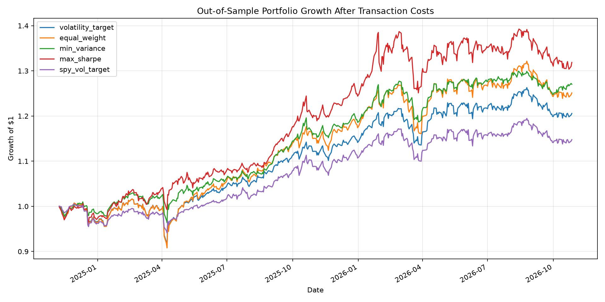
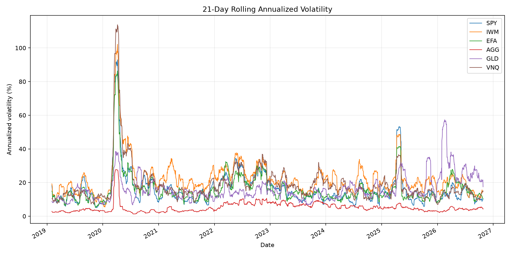

# Volatility Forecasting & Risk-Aware Portfolio Optimization

A quantitative research project evaluating statistical and machine-learning volatility forecasts and their use in risk-aware ETF portfolio construction.

## Research Questions

1. Can a Random Forest improve one-step-ahead volatility forecasts relative to standard statistical benchmarks?
2. Do forecast differences remain meaningful under walk-forward evaluation and statistical testing?
3. How do portfolio construction methods compare out of sample after transaction costs?
4. Are portfolio results sensitive to transaction costs and historical estimation windows?

## Methods

### Data

- Six ETFs: SPY, IWM, EFA, AGG, GLD, and VNQ.
- Daily adjusted closing prices retrieved using `yfinance`.
- Simple and log returns used for return analysis.
- Portfolio evaluation uses a chronological out-of-sample test period from November 8, 2024, through October 27, 2026.

### Volatility Forecasting

Forecasts target the next day's squared SPY return as a proxy for realized variance. Models include:

- Historical variance baseline
- Exponentially weighted moving average (EWMA)
- GARCH(1,1) with Student-t innovations
- Random Forest regression using lagged returns and rolling statistical features

Model evaluation uses QLIKE and mean squared error (MSE). The forecasting pipeline uses chronological training, validation-based model selection, and walk-forward refitting. Pairwise HAC tests of QLIKE loss differences use Holm adjustment for multiple comparisons.

### Portfolio Construction

Five strategies are compared:

- Equal-weight portfolio
- Global minimum-variance portfolio
- Maximum-Sharpe portfolio, using the daily 3-month U.S. Treasury yield as the risk-free rate
- Historical-volatility-targeted equal-weight exposure
- Random-Forest-SPY-volatility-targeted equal-weight exposure

The optimizer is long-only, fully invested for the optimization-based allocations, and subject to a 40% maximum weight per ETF. The volatility-targeting strategies may hold part of the portfolio in cash, which earns an approximate daily return derived from the 3-month U.S. Treasury yield.

Portfolio weights are recalculated monthly using only historical observations available before each rebalance. Transaction costs are applied to the sum of absolute changes in risky-asset weights. The baseline transaction-cost rate is 10 basis points.

## Key Results

### Volatility Forecasting

- In the final walk-forward test, the Random Forest achieved a mean QLIKE of approximately -8.488, compared with -8.443 for GARCH(1,1).
- Random Forest also achieved lower MSE than GARCH in that test.
- Pairwise HAC tests with Holm-adjusted p-values did not establish statistically significant differences between the compared forecasting models.

The results suggest that machine learning is competitive in this experiment, but do not establish that it reliably outperforms conventional volatility models.

### Portfolio Backtesting

Over the common 492-observation test period:

| Strategy | Cumulative return | Annualized return | Annualized volatility | Sharpe ratio | Maximum drawdown |
|---|---:|---:|---:|---:|---:|
| Minimum variance | 27.03% | 13.04% | 9.04% | 0.960 | -7.06% |
| Maximum Sharpe | 31.87% | 15.22% | 12.20% | 0.896 | -9.79% |
| Equal weight | 25.12% | 12.17% | 12.10% | 0.679 | -10.68% |
| Volatility target | 20.57% | 10.06% | 10.67% | 0.577 | -10.34% |
| SPY volatility target | 14.77% | 7.31% | 8.56% | 0.401 | -6.39% |

Returns are historical backtest results, not predictions of future performance.

### Portfolio Performance Uncertainty

A paired moving-block bootstrap was applied to the five strategies' daily net returns to assess sampling uncertainty.

- 2,000 bootstrap replications using circular 10-trading-day blocks.
- 95% percentile confidence intervals for annualized returns, annualized volatility, and Sharpe ratios.
- Paired comparisons of Sharpe ratios using identical resampled date blocks across strategies.

The estimated Sharpe ratios have wide 95% confidence intervals, and all five individual intervals include zero. Nine of the ten pairwise Sharpe-difference intervals include zero. The minimum-variance versus SPY-volatility-target comparison is the sole exception, with an unadjusted 95% interval of approximately [0.019, 1.133]. This result is exploratory because the ten pairwise comparisons are not adjusted for multiple testing.

The bootstrap resamples already-generated portfolio returns; it does not repeat portfolio optimization or capture uncertainty in estimated portfolio weights. The results therefore do not establish a definitive ranking of the strategies.


**Portfolio Performance**



The chart compares the cumulative performance of the five portfolio strategies over the common out-of-sample test period, after modeled transaction costs.

**Rolling Volatility Analysis**



Rolling volatility illustrates how market risk changes over time and provides context for the volatility forecasting analysis.

### Robustness Checks

- **Transaction costs:** Tested 5, 10, and 20 basis points. Strategy rankings remained unchanged across these scenarios.
- **Lookback windows:** Tested 126, 252, and 504 trading days. Results varied by strategy, especially for maximum-Sharpe optimization, indicating sensitivity to historical estimation choices.

## Repository Structure

```text
quant-volatility-research/
├── data/
│   ├── raw/
│   └── processed/
├── reports/
├── src/
├── tests/
├── requirements.txt
└── README.md
```

## Reproducibility

Create and activate a virtual environment, then install dependencies:

```bash
python3 -m venv .venv
source .venv/bin/activate
python -m pip install -r requirements.txt
```

Run the tests:

```bash
python -m pytest -q

python -m src.portfolio_bootstrap

```

Run the forecasting and analysis scripts from the project root as appropriate. The portfolio backtest requires the generated walk-forward forecast file in `reports/`.

Sensitivity analyses can be run with:

```bash
python -m src.transaction_cost_sensitivity
python -m src.lookback_sensitivity
```

## Limitations

- Squared daily returns are a noisy proxy for latent daily variance.
- The sample covers a finite historical period and may not represent other market regimes.
- Statistical tests did not establish significant forecasting-model differences after multiple-comparison adjustment.
- Transaction costs are simplified and do not explicitly model spreads, market impact, liquidity, or execution delays.
- Portfolio results depend on optimization constraints, historical estimation windows, and the selected ETF universe.

- Bootstrap intervals are conditional on the realized portfolio return series and do not capture uncertainty from re-estimating portfolio weights.
- Pairwise bootstrap comparisons are exploratory and are not adjusted for multiple comparisons.
- Cash returns and the optimizer's risk-free rate are approximated using the 3-month U.S. Treasury yield (FRED DGS3MO), converted to daily returns using 252 trading days and lagged by one calendar day. This is a proxy rather than the realized return of a specific cash instrument.

## Technology Stack

Python, NumPy, pandas, SciPy, scikit-learn, `arch`, statsmodels, Matplotlib, and yfinance.
